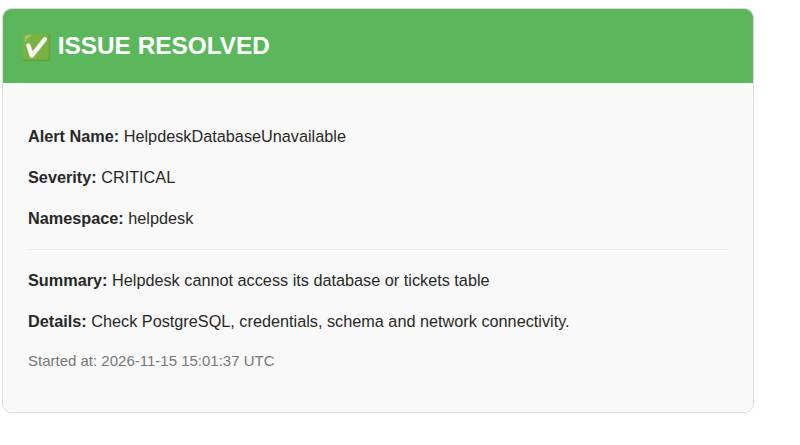

## RT-Helpdesk — End-to-End Cloud-Native DevOps Project

A production-grade deployment and automation pipeline for the **RT-Helpdesk** ticketing application. This project covers local containerization, Infrastructure as Code (IaC) on AWS, Kubernetes orchestration, automated CI/CD with Jenkins, real-time observability with Prometheus & Grafana, automated email alerting via Alertmanager, and verified disaster recovery.

---

## 1. System Architecture Diagram & Tech Stack

```text
[Developer / GitHub] 
       │
       ├──► [GitHub Actions] (PR Linting & Unit Tests)
       │
       └──► [Jenkins Controller & Build Agent (EC2 t3.micro)]
                   │  (Build, Test, Push Immutable Digest to GHCR)
                   ▼
            [GitHub Container Registry (GHCR)]
                   │
                   ▼  (Zero-Downtime Rollout via Restricted Kubeconfig)
       ┌───────────────────────────────────────────────────────┐
       │        AWS VPC — App Server (EC2 t3.small / Kind)     │
       │                                                       │
       │  ┌─────────────────────┐    ┌──────────────────────┐  │
       │  │ Namespace: helpdesk │    │ Namespace: monitoring│  │
       │  │  • API Deployment   │───►│  • Prometheus        │  │
       │  │  • PostgreSQL (PV)  │    │  • Grafana           │  │
       │  └──────────┬──────────┘    │  • Alertmanager      │  │
       └─────────────┼───────────────┴──────────┬───────────┘  │
                     │ (pg_dump)                │ (SMTP TLS)   │
                     ▼                          ▼              │
            [AWS S3 Backup Bucket]     [Gmail Alert Inbox]     │
```

| Layer | Technology | Implementation Details |
| :--- | :--- | :--- |
| **Cloud Infrastructure** | **AWS** (VPC, EC2, S3, IAM, Budgets) | Isolated VPC, Security Groups (SSH port 22 restricted to Admin IP `/32`), cost-optimized instances (`t3.micro` CI, `t3.small` App), encrypted S3 buckets, and 80% budget alerts. |
| **Infrastructure as Code** | **Terraform >= 1.10** | Two-stage architecture: `bootstrap` (versioned, encrypted S3 state bucket with native locking & `prevent_destroy`) and `lab` (compute, networking, IAM least-privilege roles). |
| **Containerization** | **Docker & Docker Compose** | Multi-stage production build running as non-root user with pinned base images and persistent volume storage. |
| **Orchestration** | **Kubernetes (Kind)** | Namespace isolation (`helpdesk`, `monitoring`), `StatefulSet` for PostgreSQL, Liveness/Readiness probes, and strict RBAC. |
| **CI/CD Automation** | **GitHub Actions, Jenkins & GHCR** | PR checks via GitHub Actions; production build, image digest push to GHCR, and K8s rollout/rollback via dedicated `helpdesk-build` agent. |
| **Observability & Alerting** | **Prometheus, Grafana, Alertmanager** | Metrics scraping (availability, request rate, error rate), Grafana dashboards, and HTML email alerts via Gmail SMTP (`FIRING` & `RESOLVED`). |
| **Backup & Recovery** | **AWS S3 & PostgreSQL** | Automated `pg_dump` backups uploaded to private S3 storage (`helpdesk-backups-egetz-2026`) and verified isolated database restores. |

---

## 2. Repository Structure

```text
helpdesk-project/
├── .github/workflows/            # GitHub Actions CI workflow for Pull Requests
├── app/                          # Python web application & automated test suite
├── docs/
│   └── images/                   # Verification screenshots & evidence
├── Dockerfile                    # Multi-stage hardened container definition
├── docker-compose.yml            # Local stack with PostgreSQL persistence
└── reference/
    ├── k8s/                      # Kubernetes manifests (App, DB, RBAC, Prometheus, Grafana, Alertmanager)
    ├── scripts/                  # Server setup, backup, restore, and synthetic traffic scripts
    └── terraform/
        ├── bootstrap/            # S3 remote state bucket & locking setup
        └── lab/                  # VPC, EC2, Security Groups, IAM, and AWS Budgets
```

---

## 3. Complete From-Scratch Build Guide (Weeks 1–6)

### Week 1: Local Docker, Persistence & Basic CI (GitHub Actions)
1. **Build and Run Locally with Docker Compose:**
   ```bash
   docker compose up -d --build
   curl -I http://localhost:8000
   ```
2. **Verify Database Persistence Across Restarts:**
   ```bash
   # Create a test ticket via UI/API, then recreate containers while keeping volumes
   docker compose down
   docker compose up -d
   # Confirm previously created tickets still exist in PostgreSQL
   ```
3. **GitHub Actions CI:**
   * Push code or open a Pull Request to trigger `.github/workflows/` automated linting and unit tests before merging to `main`.

---

### Week 2: Cloud Infrastructure Provisioning (Terraform & AWS)
1. **Bootstrap Remote Terraform State (S3 + Native Locking):**
   ```bash
   cd reference/terraform/bootstrap
   terraform init
   terraform apply -auto-approve
   # Record the output S3 bucket name (e.g., helpdesk-tfstate-<suffix>)
   ```
2. **Configure & Apply Lab Infrastructure (`VPC`, `EC2`, `S3`, `IAM`, `AWS Budgets`):**
   ```bash
   # Navigate to the main lab Terraform directory
   cd ../lab

   # Fetch your current public IP address to restrict SSH access exclusively to you
   MY_IP=\$(curl -s ifconfig.me)

   # Create backend.hcl to configure remote state storage and native S3 locking
   cat << HCL > backend.hcl
   bucket       = "<YOUR_TFSTATE_BUCKET_NAME>" # S3 bucket created in the bootstrap step
   key          = "lab/terraform.tfstate"      # Path to the state file inside the bucket
   region       = "us-east-1"                  # AWS region for the state bucket
   encrypt      = true                         # Enable server-side encryption at rest
   use_lockfile = true                         # Enable native S3 state locking to prevent concurrent edits
   HCL

   # Create terraform.tfvars to supply environment-specific variables
   cat << VARS > terraform.tfvars
   aws_region         = "us-east-1"                        # Target AWS deployment region
   admin_cidr         = "\${MY_IP}/32"                      # Lock SSH (port 22) strictly to your IP
   ssh_public_key     = "\$(cat ~/.ssh/id_ed25519.pub)"     # Public SSH key injected into EC2 instances
   ci_instance_type   = "t3.micro"                         # Cost-optimized instance for Jenkins CI
   app_instance_type  = "t3.small"                         # Cost-optimized instance for Kubernetes App
   backup_bucket_name = "helpdesk-backups-egetz-2026"      # Private S3 bucket name for database backups
   VARS

   # Initialize Terraform and connect to the remote S3 backend
   terraform init -backend-config=backend.hcl

   # Preview the infrastructure changes and save the execution plan
   terraform plan -out=lab.plan

   # Provision all AWS resources defined in the saved plan
   terraform apply lab.plan
   ```

3. **Retrieve EC2 Instance Public & Private IPs:**
   ```bash
   aws ec2 describe-instances --region us-east-1 \
     --query "Reservations[].Instances[].[InstanceId,Tags[?Key=='Name'].Value|[0],PublicIpAddress,PrivateIpAddress,State.Name]" \
     --output table
   ```

---

### Week 3: Server Hardening & Kubernetes Deployment (Kind)
1. **Upload Project Files & Run Host Bootstrap Script on `<APP_IP>`:**
   ```bash
   ssh ubuntu@<APP_IP> "sudo mkdir -p /opt/rt-helpdesk && sudo chown -R ubuntu:ubuntu /opt/rt-helpdesk"
   scp -r app reference ubuntu@<APP_IP>:/opt/rt-helpdesk/

   ssh ubuntu@<APP_IP> "
     sudo apt-get update && sudo apt-get install -y docker.io curl jq postgresql-client awscli
     sudo usermod -aG docker ubuntu
     curl -Lo ./kind https://k8s.io
     chmod +x ./kind && sudo mv ./kind /usr/local/bin/kind
     curl -LO https://k8s.io
     chmod +x kubectl && sudo mv kubectl /usr/local/bin/kubectl
     kind create cluster --name helpdesk
   "
   ```
2. **Deploy Namespaces, RBAC, PostgreSQL & RT-Helpdesk Application:**
   ```bash
   ssh ubuntu@<APP_IP> "
     cd /opt/rt-helpdesk
     kubectl create namespace helpdesk
     kubectl create namespace monitoring
     kubectl apply -f reference/k8s/jenkins-rbac.yaml
     kubectl apply -f reference/k8s/app.yaml
     kubectl -n helpdesk get pods
   "
   ```

---

### Week 4: Full CI/CD Automation & Rollback (Jenkins & GHCR)
1. **Install Jenkins & Configure Dedicated Build Agent (`buildagent`) on `<CI_IP>`:**
   ```bash
   ssh ubuntu@<CI_IP> "
     sudo apt-get update && sudo apt-get install -y fontconfig openjdk-17-jre docker.io git
     sudo wget -O /usr/share/keyrings/jenkins-keyring.asc https://jenkins.io
     echo 'deb [signed-by=/usr/share/keyrings/jenkins-keyring.asc] https://jenkins.io binary/' | sudo tee /etc/apt/sources.list.d/jenkins.list > /dev/null
     sudo apt-get update && sudo apt-get install -y jenkins
     sudo systemctl enable --now jenkins

     sudo useradd -m -s /bin/bash buildagent
     sudo usermod -aG docker buildagent
     sudo -u jenkins ssh-keygen -t ed25519 -f /var/lib/jenkins/.ssh/id_ed25519 -N ''
     sudo mkdir -p /home/buildagent/.ssh
     sudo cp /var/lib/jenkins/.ssh/id_ed25519.pub /home/buildagent/.ssh/authorized_keys
     sudo chown -R buildagent:buildagent /home/buildagent/.ssh
     sudo chmod 700 /home/buildagent/.ssh && sudo chmod 600 /home/buildagent/.ssh/authorized_keys
   "
   ```
2. **Authorize Jenkins SSH Access to App Server & Configure Pipeline:**
   ```bash
   JENKINS_PUB=$(ssh ubuntu@<CI_IP> "sudo cat /var/lib/jenkins/.ssh/id_ed25519.pub")
   ssh ubuntu@<APP_IP> "echo '$JENKINS_PUB' >> ~/.ssh/authorized_keys"
   ```
   * Open Jenkins (`ssh -L 8080:127.0.0.1:8080 ubuntu@<CI_IP> -N`), add the `helpdesk-build` agent node, store GHCR credentials, and run `helpdesk-release` on push to `main`.
3. **Rollback Procedure (In Case of Failed Deployment):**
   ```bash
   ssh ubuntu@<APP_IP> "
     kubectl -n helpdesk rollout undo deployment/api && \
     kubectl -n helpdesk rollout status deployment/api
   "
   ```

---

### Week 5: Monitoring, Alertmanager & S3 Backup/Restore
1. **Deploy Prometheus, Grafana & Alertmanager (Gmail SMTP):**
   ```bash
   ssh ubuntu@<APP_IP> "
     cd /opt/rt-helpdesk
     kubectl -n monitoring create secret generic alertmanager-smtp \
       --from-literal=smtp_password='<YOUR_16_CHAR_GOOGLE_APP_PASSWORD>'
     kubectl -n monitoring create configmap prometheus-config \
       --from-file=prometheus.yml=reference/k8s/prometheus.yml \
       --from-file=alerts.yml=reference/k8s/alerts.yml
     kubectl apply -f reference/k8s/monitoring.yaml
     kubectl apply -f reference/k8s/alertmanager.yaml
     kubectl -n monitoring get pods
   "
   ```
2. **Generate Traffic & Verify Metrics (Availability, Request Rate, Error Rate):**
   ```bash
   python3 reference/scripts/traffic.py --seconds 180
   ```
3. **Run Automated S3 Backup & Isolated Database Restore Verification:**
   ```bash
   # Backup to S3
   ssh ubuntu@<APP_IP> "bash /opt/rt-helpdesk/reference/scripts/k8s-backup.sh helpdesk helpdesk-backups-egetz-2026"
   aws s3 ls s3://helpdesk-backups-egetz-2026/backups/helpdesk/

   # Isolated Restore Check
   ssh ubuntu@<APP_IP> "
     aws s3 cp s3://helpdesk-backups-egetz-2026/backups/helpdesk/<LATEST_DUMP>.dump /tmp/restore.dump && \
     kubectl -n helpdesk cp /tmp/restore.dump db-0:/tmp/restore.dump && \
     kubectl -n helpdesk exec db-0 -- psql -U postgres -c 'CREATE DATABASE helpdesk_restore_check1;' && \
     kubectl -n helpdesk exec db-0 -- pg_restore -U postgres -d helpdesk_restore_check1 /tmp/restore.dump && \
     kubectl -n helpdesk exec db-0 -- psql -U postgres -d helpdesk_restore_check1 -c '\dt' && \
     kubectl -n helpdesk exec db-0 -- psql -U postgres -c 'DROP DATABASE helpdesk_restore_check1;'
   "
   ```

---

### Week 6: Cost Control, Operations & Final Teardown
* **Open Local SSH Tunnels to Web Interfaces:**
  ```bash
  # App (8000), Prometheus (9090), Grafana (3000)
  ssh -L 8000:127.0.0.1:8000 -L 9090:127.0.0.1:9090 -L 3000:127.0.0.1:3000 ubuntu@<APP_IP>

  # Jenkins (8080)
  ssh -L 8080:127.0.0.1:8080 ubuntu@<CI_IP> -N
  ```
* **Pause Lab Between Sessions (Stop EC2 Instances):**
  ```bash
  aws ec2 stop-instances --region us-east-1 --instance-ids <CI_INSTANCE_ID> <APP_INSTANCE_ID>
  ```
* **Final Environment Destruction After Grading (`Teardown` — Zero Cost):**
  ```bash
  aws s3 rm s3://helpdesk-backups-egetz-2026 --recursive
  cd ~/devops/projects/helpdesk-project/reference/terraform/lab
  terraform destroy -auto-approve
  ```

---

## 4. Security & Cost Optimization Highlights

* **Zero Public App Ports:** No HTTP/HTTPS, database, Jenkins, Prometheus, or Grafana ports are exposed to the public internet. All administrative access uses encrypted **SSH Local Port Forwarding**.
* **Secrets Management:** Sensitive credentials (such as Gmail SMTP App Passwords and GHCR tokens) are never committed to Git; they are injected at runtime using **Kubernetes Secrets** (`readOnly: true` volume mounts) and Jenkins Credentials.
* **Least-Privilege IAM:** The application EC2 instance uses an IAM role restricted strictly to S3 backup object operations, with zero infrastructure-admin permissions.
* **Cost-Optimized Compute:** Instance types in `variables.tf` and `terraform.tfvars` are tuned to `t3.micro` (Jenkins) and `t3.small` (Kubernetes App) alongside AWS Budgets alerts to prevent unexpected cloud spend.

---

## 5. Alertmanager & Gmail SMTP Configuration

To enable real-time email notifications without incurring extra third-party email service costs, **Prometheus Alertmanager** is configured to relay alerts through Google's free SMTP server (`://gmail.com`) using TLS encryption and a dedicated **Google App Password**.

* **Kubernetes Secret (`alertmanager-smtp`):** Stores the App Password securely inside the `monitoring` namespace and mounts it read-only at `/etc/alertmanager/secrets/smtp_password`.
* **Dynamic HTML Notifications (`reference/k8s/alertmanager.yaml`):** Configured `send_resolved: true` with a custom HTML template rendering a **Red (`[FIRING]`)** banner on outage and a **Green (`[RESOLVED]`)** banner upon recovery.
* **Prometheus Integration (`reference/k8s/prometheus.yml`):** Routes alerts to `alertmanager.monitoring.svc.cluster.local:9093`.

---

## 6. Operational Exercises & Verification Evidence

### Exercise 1: End-to-End Application & Observability Health
* **RT-Helpdesk Web UI (`http://localhost:8000`):**
  
* **Prometheus Scrape Targets (`http://localhost:9090/targets`):**
  
* **Grafana Live Dashboard (`http://localhost:3000`):**
  

### Exercise 2: Jenkins Dedicated Build Agent Verification
1. Open Jenkins (`http://localhost:8080`) -> **+ New Item** -> name **`agent-verify`** -> **Pipeline**.
2. Paste the verification script under **Pipeline script**, save, and click **Build Now**:
   ```groovy
   pipeline {
     agent { label 'helpdesk-build' }
     stages {
       stage('Verify Build Agent') {
         steps {
           sh 'id -un && docker version'
         }
       }
     }
   }
   ```
* **Jenkins Console Output (`id -un` & `docker version`):**
  

### Exercise 3: Database Outage & Graceful Degradation (Chaos Exercise)
Scaled PostgreSQL `StatefulSet` to `0` (`kubectl -n helpdesk scale statefulset db --replicas=0`) to verify that the API stays alive (Liveness passes), fails Readiness, returns **`503 Service Unavailable`**, and triggers `HelpdeskDatabaseUnavailable` (`FIRING`) in Prometheus.

* **API Graceful Degradation (`503 Service Unavailable`):**
  
* **Prometheus Firing Alert (`http://localhost:9090/alerts`):**
  

### Exercise 4: Real-Time Email Alerting & Auto-Recovery (Alertmanager)
* **Firing Alert Email Notification:**
  
* **Resolved Recovery Email Notification:**
  

