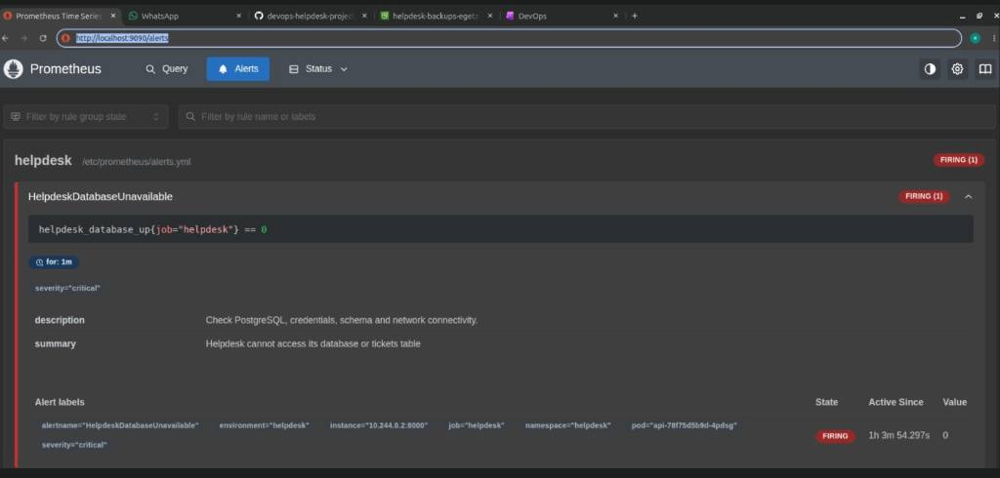

# RT-Helpdesk — End-to-End Cloud-Native DevOps Project

A production-grade deployment and automation pipeline for the **RT-Helpdesk** ticketing application. This project demonstrates Infrastructure as Code (IaC), container hardening, Kubernetes orchestration, automated CI/CD with Jenkins, real-time observability with Prometheus & Grafana, automated email alerting via Alertmanager, and verified disaster recovery on AWS.

---

## 1. System Architecture & Tech Stack

| Layer | Technology | Implementation Details |
| :--- | :--- | :--- |
| **Cloud Infrastructure** | **AWS** (VPC, EC2, S3, IAM, Budgets) | Isolated VPC, hardened Security Groups (SSH port 22 restricted to Admin IP `/32`), cost-optimized EC2 instances (`t3.micro` CI, `t3.small` App), encrypted S3 buckets, and automated 80% budget alerts. |
| **Infrastructure as Code** | **Terraform >= 1.10** | Two-stage architecture: `bootstrap` (versioned, encrypted S3 state bucket with native S3 locking & `prevent_destroy`) and `lab` (compute, networking, IAM least-privilege roles). |
| **Containerization** | **Docker** | Multi-stage production build running as a non-root user with pinned base images and minimal attack surface. |
| **Orchestration** | **Kubernetes (Kind)** | Namespace isolation (`helpdesk` for application/DB, `monitoring` for observability), persistent volumes (`StatefulSet` for PostgreSQL), Liveness/Readiness probes, and strict RBAC. |
| **CI/CD Automation** | **Jenkins & GHCR** | Dedicated build agent (`helpdesk-build`), automated testing, container image signing/pushing to GitHub Container Registry using immutable digests, and zero-downtime Kubernetes rollouts. |
| **Observability & Alerting** | **Prometheus, Grafana, Alertmanager** | Live metrics scraping, custom Grafana dashboards, and real-time HTML email notifications via Gmail SMTP (`FIRING` & `RESOLVED` states) backed by Kubernetes Secrets. |
| **Backup & Recovery** | **AWS S3 & PostgreSQL** | Automated `pg_dump` backups uploaded to private S3 storage (`helpdesk-backups-egetz-2026`) and verified isolated database restores. |

---

## 2. Repository Structure

```text
helpdesk-project/
├── app/                          # Python FastAPI application & unit/integration tests
├── docs/
│   └── images/                   # Verification screenshots & evidence
└── reference/
    ├── k8s/                      # Kubernetes manifests (App, DB, RBAC, Prometheus, Grafana, Alertmanager)
    ├── scripts/                  # Backup, restore, and synthetic traffic generation scripts
    └── terraform/
        ├── bootstrap/            # S3 remote state bucket & locking setup
        └── lab/                  # VPC, EC2, Security Groups, IAM, and AWS Budgets
```

---

## 3. Security & Cost Optimization Highlights

* **Zero Public App Ports:** No HTTP/HTTPS, database, Jenkins, Prometheus, or Grafana ports are exposed to the public internet. All administrative access uses encrypted **SSH Local Port Forwarding**.
* **Secrets Management:** Sensitive credentials (such as Gmail SMTP App Passwords and GHCR tokens) are never committed to Git; they are injected at runtime using **Kubernetes Secrets** (`readOnly: true` volume mounts) and Jenkins Credentials.
* **Least-Privilege IAM:** The application EC2 instance uses an IAM role restricted strictly to S3 backup object operations, with zero infrastructure-admin permissions.
* **Cost-Optimized Compute:** Instance types in `variables.tf` and `terraform.tfvars` are tuned to `t3.micro` (Jenkins) and `t3.small` (Kubernetes App) alongside AWS Budgets alerts to prevent unexpected cloud spend.

---

## 4. Step-by-Step Project Build Guide (Phases 1–6)

### Phase 1: Cloud Infrastructure Provisioning (Terraform & AWS)
1. **Bootstrap Remote Terraform State (S3 + Native Locking):**
   ```bash
   cd reference/terraform/bootstrap
   terraform init
   terraform apply -auto-approve
   ```
2. **Deploy Lab Infrastructure (VPC, EC2, Security Groups, IAM, Budgets):**
   Configure `terraform.tfvars` with your Admin IP (`/32`), SSH public key, and cost-optimized instance types (`t3.micro` / `t3.small`), then apply:
   ```bash
   cd ../lab
   terraform init -backend-config=backend.hcl
   terraform plan -out=lab.plan
   terraform apply lab.plan
   ```
3. **Retrieve EC2 Instance Public & Private IPs:**
   ```bash
   aws ec2 describe-instances --region us-east-1 \
     --query "Reservations[].Instances[].[InstanceId,Tags[?Key=='Name'].Value|[0],PublicIpAddress,PrivateIpAddress,State.Name]" \
     --output table
   ```

---

### Phase 2: Kubernetes Cluster & Observability Deployment (Kind)
1. **Verify Cluster Pods Across Namespaces (`helpdesk` & `monitoring`):**
   ```bash
   ssh ubuntu@<APP_IP> "kubectl get pods -A"
   ```
2. **Verify Host Memory & Disk Capacity:**
   ```bash
   ssh ubuntu@<APP_IP> "free -h && df -h /"
   ```
3. **Open Secure SSH Tunnels to Application, Prometheus, and Grafana:**
   ```bash
   # Application UI (Port 8000)
   ssh -L 8000:127.0.0.1:8000 ubuntu@<APP_IP> "kubectl -n helpdesk port-forward service/api 8000:8000"

   # Prometheus UI (Port 9090)
   ssh -L 9090:127.0.0.1:9090 ubuntu@<APP_IP> "kubectl -n monitoring port-forward service/prometheus 9090:9090"

   # Grafana UI (Port 3000)
   ssh -L 3000:127.0.0.1:3000 ubuntu@<APP_IP> "kubectl -n monitoring port-forward service/grafana 3000:3000"
   ```
4. **Generate Synthetic Traffic to Populate Metrics & Dashboards:**
   ```bash
   python3 reference/scripts/traffic.py --seconds 180
   ```

---

### Phase 3: CI/CD Pipeline & Build Agent Setup (Jenkins & GHCR)
1. **Open SSH Tunnel to Jenkins Controller (Port 8080):**
   ```bash
   ssh -L 8080:127.0.0.1:8080 ubuntu@<CI_IP> -N
   ```
2. **Configure Dedicated Build Agent & Kubernetes RBAC:**
   * Generate ED25519 SSH keypairs for Jenkins-to-Agent (`helpdesk-build`) and Agent-to-App deployment access.
   * Grant least-privilege deployment permissions in the `helpdesk` namespace:
     ```bash
     ssh ubuntu@<APP_IP> "kubectl apply -f /opt/rt-helpdesk/reference/k8s/jenkins-rbac.yaml"
     ```
3. **Trigger Automated Build, Image Digest Push & K8s Rollout:**
   ```bash
   git add .
   git commit -m "ci: trigger automated build and digest deployment"
   git push origin main
   ```

---

### Phase 4: Automated S3 Backups & Verified Database Restore
1. **Run PostgreSQL Backup Script (`pg_dump` -> AWS S3):**
   ```bash
   ssh ubuntu@<APP_IP> "bash /opt/rt-helpdesk/reference/scripts/k8s-backup.sh helpdesk helpdesk-backups-egetz-2026"
   ```
2. **Verify Backup Artifact in S3:**
   ```bash
   aws s3 ls s3://helpdesk-backups-egetz-2026/backups/helpdesk/
   ```
3. **Perform Isolated Database Restore Verification:**
   ```bash
   ssh ubuntu@<APP_IP> "
     aws s3 cp s3://helpdesk-backups-egetz-2026/backups/helpdesk/<LATEST_DUMP>.dump /tmp/restore.dump && \
     kubectl -n helpdesk cp /tmp/restore.dump db-0:/tmp/restore.dump && \
     kubectl -n helpdesk exec db-0 -- psql -U postgres -c 'CREATE DATABASE helpdesk_restore_check1;' && \
     kubectl -n helpdesk exec db-0 -- pg_restore -U postgres -d helpdesk_restore_check1 /tmp/restore.dump && \
     kubectl -n helpdesk exec db-0 -- psql -U postgres -d helpdesk_restore_check1 -c '\dt' && \
     kubectl -n helpdesk exec db-0 -- psql -U postgres -c 'DROP DATABASE helpdesk_restore_check1;'
   "
   ```

---

### Phase 5: Chaos Engineering & Real-Time Email Alerting
1. **Simulate Database Outage (`scale=0`):**
   ```bash
   ssh ubuntu@<APP_IP> "kubectl -n helpdesk scale statefulset db --replicas=0"
   ```
2. **Verify API Graceful Degradation (`503 Service Unavailable`):**
   ```bash
   ssh ubuntu@<APP_IP> "kubectl -n helpdesk exec deploy/api -- python3 -c 'import urllib.request as u, urllib.error as e; p=8000;
   try: u.urlopen(f\"http://127.0.0.1:{p}/api/tickets\", timeout=5)
   except e.HTTPError as err: print(err.code, err.reason, err.read().decode())'"
   ```
3. **Verify Firing Alert & Email Notification (`[FIRING]`):**
   * Confirm `HelpdeskDatabaseUnavailable` transitions to **`FIRING`** in Prometheus (`http://localhost:9090/alerts`).
   * Confirm receipt of the red **`[FIRING]`** HTML alert email via Alertmanager.
4. **Restore Database & Verify Auto-Recovery (`[RESOLVED]`):**
   ```bash
   ssh ubuntu@<APP_IP> "kubectl -n helpdesk scale statefulset db --replicas=1 && kubectl -n helpdesk rollout status statefulset/db"
   ```

---

### Phase 6: Cost Control & Final Teardown
* **Option A — Pause Lab Between Sessions (Stop EC2 Instances):**
  ```bash
  aws ec2 stop-instances --region us-east-1 --instance-ids <CI_INSTANCE_ID> <APP_INSTANCE_ID>
  ```
* **Option B — Full Environment Destruction After Grading (`Teardown`):**
  ```bash
  aws s3 rm s3://helpdesk-backups-egetz-2026 --recursive
  cd reference/terraform/lab
  terraform destroy -auto-approve
  ```

---

## 5. Alertmanager & Gmail SMTP Configuration

To enable real-time email notifications without incurring extra third-party email service costs, **Prometheus Alertmanager** is configured to relay alerts through Google's free SMTP server (`smtp.gmail.com:587`) using TLS encryption and a dedicated **Google App Password**.

### 1. Security & Secrets Management
* **Google App Password:** Generated a dedicated 16-character App Password under Google Account Security (with 2-Step Verification enabled), avoiding the use of primary account credentials.
* **Kubernetes Secret (`alertmanager-smtp`):** Stored the App Password securely inside the `monitoring` namespace rather than hardcoding it in Git:
  ```bash
  kubectl -n monitoring create secret generic alertmanager-smtp \
    --from-literal=smtp_password='<GOOGLE_APP_PASSWORD>'
  ```
* **Read-Only Volume Mount:** Mounted the secret into the Alertmanager pod at `/etc/alertmanager/secrets/smtp_password` (`readOnly: true`) and referenced it via `smtp_auth_password_file`.

### 2. Alert Routing & Custom HTML Template (`reference/k8s/alertmanager.yaml`)
* **SMTP Relay:** Configured `smtp_smarthost: 'smtp.gmail.com:587'` with `smtp_require_tls: true`.
* **Grouping & Deduplication:** Alerts are grouped by `alertname` (`group_wait: 10s`, `repeat_interval: 1h`) to prevent inbox flooding during outages.
* **Dynamic HTML Notifications:** Configured `send_resolved: true` with a custom HTML template that renders a **Red (`[FIRING]`)** banner when an incident starts and a **Green (`[RESOLVED]`)** banner upon automatic recovery.

### 3. Prometheus Integration (`reference/k8s/prometheus.yml`)
Connected Prometheus to the internal Alertmanager Kubernetes `Service` endpoint:
```yaml
alerting:
  alertmanagers:
    - static_configs:
        - targets:
            - alertmanager.monitoring.svc.cluster.local:9093
```

---

## 6. Operational Exercises & Verification Evidence

### Exercise 1: End-to-End Application & Observability Health
Verified that the **RT-Helpdesk** web application is live with the latest Git commit SHA badge, Prometheus actively scrapes the `/metrics` endpoint (`UP`), and Grafana visualizes real-time request rates and target health.

* **RT-Helpdesk Web UI (`http://localhost:8000`):**
  
* **Prometheus Scrape Targets (`http://localhost:9090/targets`):**
  
* **Grafana Live Dashboard (`http://localhost:3000`):**
  

---

### Exercise 2: Jenkins Dedicated Build Agent Verification
Configured a dedicated `helpdesk-build` agent node and created a verification Pipeline job (`agent-verify`) to confirm non-root execution (`buildagent`) and Docker Engine availability on the build node.

#### Job Setup Instructions
1. Open the Jenkins UI (`http://localhost:8080`) via SSH tunnel and click **+ New Item**.
2. Enter the item name **`agent-verify`**, select **Pipeline**, and click **OK**.
3. Under **Pipeline -> Definition**, choose **Pipeline script** and paste the following declarative script:
   ```groovy
   pipeline {
     agent { label 'helpdesk-build' }
     stages {
       stage('Verify Build Agent') {
         steps {
           sh 'id -un && docker version'
         }
       }
     }
   }
   ```
4. Click **Save** and trigger **Build Now** to verify the console output.

* **Jenkins Console Output (`id -un` & `docker version`):**
  

---

### Exercise 3: Database Outage & Graceful Degradation (Chaos Exercise)
Simulated a database outage by scaling the PostgreSQL `StatefulSet` to `0` (`kubectl -n helpdesk scale statefulset db --replicas=0`):
1. The API container remained alive (Liveness probe passed) while failing its Readiness probe to stop receiving normal service traffic.
2. Direct requests to the API pod cleanly returned **`503 Service Unavailable`** (`database_unavailable`) instead of crashing.
3. Prometheus detected the failure and transitioned `HelpdeskDatabaseUnavailable` to **`FIRING`**.

* **API Graceful Degradation (`503 Service Unavailable`):**
  
* **Prometheus Firing Alert (`http://localhost:9090/alerts`):**
  

---

### Exercise 4: Real-Time Email Alerting & Auto-Recovery (Alertmanager)
Integrated **Prometheus Alertmanager** with Gmail SMTP (`smtp.gmail.com:587`) using a custom HTML template and a Kubernetes Secret (`alertmanager-smtp`):
1. Upon database failure, Alertmanager immediately dispatched a red **`[FIRING]`** HTML alert email.
2. After scaling the database back to `1` (`kubectl -n helpdesk scale statefulset db --replicas=1`), the cluster self-healed and Alertmanager dispatched a green **`[RESOLVED]`** recovery email.

* **Firing Alert Email Notification:**
  
* **Resolved Recovery Email Notification:**
  


