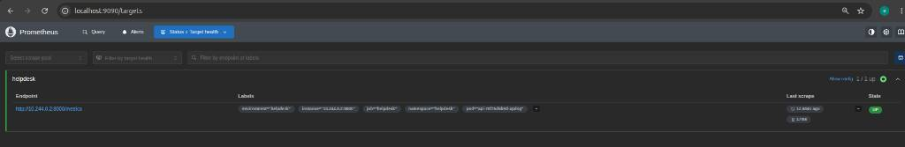
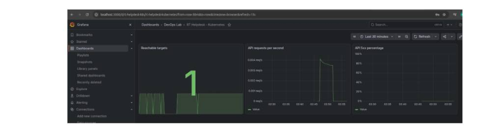
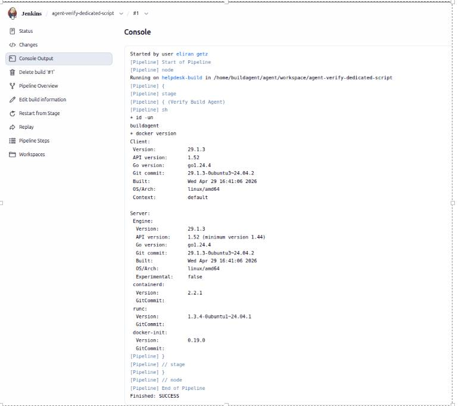

cd ~/devops/projects/helpdesk-project && \
cat << 'EOF' > README.md
# RT-Helpdesk — End-to-End Cloud-Native DevOps Project

A production-grade deployment and automation pipeline for the **RT-Helpdesk** ticketing application. This project demonstrates Infrastructure as Code (IaC), container hardening, Kubernetes orchestration, automated CI/CD with Jenkins, real-time observability with Prometheus & Grafana, automated email alerting via Alertmanager, and verified disaster recovery on AWS.

---

## 1. System Architecture & Tech Stack

| Layer | Technology | Implementation Details |
| :--- | :--- | :--- |
| **Cloud Infrastructure** | **AWS** (VPC, EC2, S3, IAM, Budgets) | Isolated VPC, hardened Security Groups (SSH port 22 restricted to Admin IP `/32`), cost-optimized EC2 instances (`t3.micro` CI, `t3.small` App), encrypted S3 buckets, and automated 80% budget alerts. |
| **Infrastructure as Code** | **Terraform >= 1.10** | Two-stage architecture: `bootstrap` (versioned, encrypted S3 state bucket with native S3 locking & `prevent_destroy`) and `lab` (compute, networking, IAM least-privilege roles). |
| **Containerization** | **Docker** | Multi-stage production build running as a non-root user with pinned base images and minimal attack surface. |
| **Orchestration** | **Kubernetes (Kind)** | Namespace isolation (`helpdesk` for application/DB, `monitoring` for observability), persistent volumes (`StatefulSet` for PostgreSQL), Liveness/Readiness probes, and strict RBAC. |
| **CI/CD Automation** | **Jenkins & GHCR** | Dedicated build agent (`helpdesk-build`), automated testing, container image signing/pushing to GitHub Container Registry using immutable digests, and zero-downtime Kubernetes rollouts. |
| **Observability & Alerting** | **Prometheus, Grafana, Alertmanager** | Live metrics scraping, custom Grafana dashboards, and real-time HTML email notifications via Gmail SMTP (`FIRING` & `RESOLVED` states) backed by Kubernetes Secrets. |
| **Backup & Recovery** | **AWS S3 & PostgreSQL** | Automated `pg_dump` backups uploaded to private S3 storage (`helpdesk-backups-egetz-2026`) and verified isolated database restores. |

---

## 2. Repository Structure

```text
helpdesk-project/
├── app/                          # Python FastAPI application & unit/integration tests
├── docs/
│   └── images/                   # Verification screenshots & evidence
└── reference/
    ├── k8s/                      # Kubernetes manifests (App, DB, RBAC, Prometheus, Grafana, Alertmanager)
    ├── scripts/                  # Backup, restore, and synthetic traffic generation scripts
    └── terraform/
        ├── bootstrap/            # S3 remote state bucket & locking setup
        └── lab/                  # VPC, EC2, Security Groups, IAM, and AWS Budgets
```

---

## 3. Complete From-Scratch Build Guide (Zero to Production)

Follow these step-by-step instructions to rebuild the entire environment from scratch on a clean AWS account.

### Step 1: Bootstrap Terraform Remote State (S3)
Create the encrypted, versioned S3 bucket used to store Terraform state files.
```bash
cd reference/terraform/bootstrap
terraform init
terraform apply -auto-approve
# Note the output bucket name (e.g., helpdesk-tfstate-<suffix>)
```

### Step 2: Provision AWS Cloud Infrastructure (`lab`)
1. Create `backend.hcl` and `terraform.tfvars` inside `reference/terraform/lab`:
   ```bash
   cd ../lab
   MY_IP=$(curl -s ifconfig.me)

   cat << HCL > backend.hcl
   bucket       = "<YOUR_TFSTATE_BUCKET_NAME>"
   key          = "lab/terraform.tfstate"
   region       = "us-east-1"
   encrypt      = true
   use_lockfile = true
   HCL

   cat << VARS > terraform.tfvars
   aws_region        = "us-east-1"
   admin_cidr        = "${MY_IP}/32"
   ssh_public_key    = "$(cat ~/.ssh/id_ed25519.pub)"
   ci_instance_type  = "t3.micro"
   app_instance_type = "t3.small"
   backup_bucket_name = "helpdesk-backups-egetz-2026"
   VARS
   ```
2. Initialize and apply the Terraform configuration:
   ```bash
   terraform init -backend-config=backend.hcl
   terraform plan -out=lab.plan
   terraform apply lab.plan
   ```
3. Retrieve the public and private IPs of both EC2 instances:
   ```bash
   aws ec2 describe-instances --region us-east-1 \
     --query "Reservations[].Instances[].[InstanceId,Tags[?Key=='Name'].Value|[0],PublicIpAddress,PrivateIpAddress,State.Name]" \
     --output table
   ```

### Step 3: Bootstrap Application Server (Docker, Kind & Kubernetes)
1. Copy the repository files to the App EC2 instance (`<APP_IP>`):
   ```bash
   cd ~/devops/projects/helpdesk-project
   ssh ubuntu@<APP_IP> "sudo mkdir -p /opt/rt-helpdesk && sudo chown -R ubuntu:ubuntu /opt/rt-helpdesk"
   scp -r app reference ubuntu@<APP_IP>:/opt/rt-helpdesk/
   ```
2. Install Docker, `kubectl`, and `kind` on `<APP_IP>`, and initialize the Kubernetes cluster:
   ```bash
   ssh ubuntu@<APP_IP> "
     sudo apt-get update && sudo apt-get install -y docker.io curl jq postgresql-client awscli
     sudo usermod -aG docker ubuntu
     curl -Lo ./kind https://k8s.io
     chmod +x ./kind && sudo mv ./kind /usr/local/bin/kind
     curl -LO https://k8s.io
     chmod +x kubectl && sudo mv kubectl /usr/local/bin/kubectl
     kind create cluster --name helpdesk
   "
   ```
3. Deploy Namespaces, Application, PostgreSQL Database, and Monitoring Stack:
   ```bash
   ssh ubuntu@<APP_IP> "
     cd /opt/rt-helpdesk
     kubectl create namespace helpdesk
     kubectl create namespace monitoring
     kubectl apply -f reference/k8s/jenkins-rbac.yaml
     kubectl apply -f reference/k8s/app.yaml
     kubectl -n monitoring create configmap prometheus-config \
       --from-file=prometheus.yml=reference/k8s/prometheus.yml \
       --from-file=alerts.yml=reference/k8s/alerts.yml
     kubectl apply -f reference/k8s/monitoring.yaml
   "
   ```

### Step 4: Configure Alertmanager & Gmail SMTP Notifications
1. Create the Kubernetes Secret storing your 16-character Google App Password:
   ```bash
   ssh ubuntu@<APP_IP> "
     kubectl -n monitoring create secret generic alertmanager-smtp \
       --from-literal=smtp_password='<YOUR_16_CHAR_GOOGLE_APP_PASSWORD>'
   "
   ```
2. Deploy Alertmanager and reload Prometheus:
   ```bash
   ssh ubuntu@<APP_IP> "
     kubectl apply -f /opt/rt-helpdesk/reference/k8s/alertmanager.yaml
     kubectl -n monitoring rollout restart deployment/prometheus
     kubectl -n monitoring get pods
   "
   ```

### Step 5: Bootstrap CI Server (Jenkins & Build Agent)
1. Install Java, Jenkins, and Docker on the CI EC2 instance (`<CI_IP>`):
   ```bash
   ssh ubuntu@<CI_IP> "
     sudo apt-get update && sudo apt-get install -y fontconfig openjdk-17-jre docker.io git
     sudo wget -O /usr/share/keyrings/jenkins-keyring.asc https://jenkins.io
     echo 'deb [signed-by=/usr/share/keyrings/jenkins-keyring.asc] https://jenkins.io binary/' | sudo tee /etc/apt/sources.list.d/jenkins.list > /dev/null
     sudo apt-get update && sudo apt-get install -y jenkins
     sudo systemctl enable --now jenkins
   "
   ```
2. Create the dedicated `buildagent` user and configure SSH keys between Jenkins and `<APP_IP>`:
   ```bash
   ssh ubuntu@<CI_IP> "
     sudo useradd -m -s /bin/bash buildagent
     sudo usermod -aG docker buildagent
     sudo -u jenkins ssh-keygen -t ed25519 -f /var/lib/jenkins/.ssh/id_ed25519 -N ''
     sudo mkdir -p /home/buildagent/.ssh
     sudo cp /var/lib/jenkins/.ssh/id_ed25519.pub /home/buildagent/.ssh/authorized_keys
     sudo chown -R buildagent:buildagent /home/buildagent/.ssh
     sudo chmod 700 /home/buildagent/.ssh && sudo chmod 600 /home/buildagent/.ssh/authorized_keys
   "
   ```
3. Copy Jenkins public key to `<APP_IP>` and extract the restricted `kubeconfig` for Jenkins deployments:
   ```bash
   JENKINS_PUB=$(ssh ubuntu@<CI_IP> "sudo cat /var/lib/jenkins/.ssh/id_ed25519.pub")
   ssh ubuntu@<APP_IP> "echo '$JENKINS_PUB' >> ~/.ssh/authorized_keys"
   ```
4. Access Jenkins via SSH Tunnel (`ssh -L 8080:127.0.0.1:8080 ubuntu@<CI_IP> -N`), unlock it using `sudo cat /var/lib/jenkins/secrets/initialAdminPassword`, add the `helpdesk-build` node, and configure your GHCR credentials and `helpdesk-release` Pipeline job.

### Step 6: Verification, Backups & Teardown
1. **Generate Traffic & Verify Dashboards:**
   ```bash
   python3 reference/scripts/traffic.py --seconds 180
   ```
2. **Run S3 Backup & Isolated Restore Check:**
   ```bash
   ssh ubuntu@<APP_IP> "bash /opt/rt-helpdesk/reference/scripts/k8s-backup.sh helpdesk helpdesk-backups-egetz-2026"
   aws s3 ls s3://helpdesk-backups-egetz-2026/backups/helpdesk/
   ```
3. **Teardown Everything After Grading (Zero Cost):**
   ```bash
   aws s3 rm s3://helpdesk-backups-egetz-2026 --recursive
   cd ~/devops/projects/helpdesk-project/reference/terraform/lab
   terraform destroy -auto-approve
   ```

---

## 4. Security & Cost Optimization Highlights

* **Zero Public App Ports:** No HTTP/HTTPS, database, Jenkins, Prometheus, or Grafana ports are exposed to the public internet. All administrative access uses encrypted **SSH Local Port Forwarding**.
* **Secrets Management:** Sensitive credentials (such as Gmail SMTP App Passwords and GHCR tokens) are never committed to Git; they are injected at runtime using **Kubernetes Secrets** (`readOnly: true` volume mounts) and Jenkins Credentials.
* **Least-Privilege IAM:** The application EC2 instance uses an IAM role restricted strictly to S3 backup object operations, with zero infrastructure-admin permissions.
* **Cost-Optimized Compute:** Instance types in `variables.tf` and `terraform.tfvars` are tuned to `t3.micro` (Jenkins) and `t3.small` (Kubernetes App) alongside AWS Budgets alerts to prevent unexpected cloud spend.

---

## 5. Alertmanager & Gmail SMTP Configuration

To enable real-time email notifications without incurring extra third-party email service costs, **Prometheus Alertmanager** is configured to relay alerts through Google's free SMTP server (`://gmail.com`) using TLS encryption and a dedicated **Google App Password**.

### 1. Security & Secrets Management
* **Google App Password:** Generated a dedicated 16-character App Password under Google Account Security (with 2-Step Verification enabled), avoiding the use of primary account credentials.
* **Kubernetes Secret (`alertmanager-smtp`):** Stored the App Password securely inside the `monitoring` namespace rather than hardcoding it in Git:
  ```bash
  kubectl -n monitoring create secret generic alertmanager-smtp \
    --from-literal=smtp_password='<GOOGLE_APP_PASSWORD>'
  ```
* **Read-Only Volume Mount:** Mounted the secret into the Alertmanager pod at `/etc/alertmanager/secrets/smtp_password` (`readOnly: true`) and referenced it via `smtp_auth_password_file`.

### 2. Alert Routing & Custom HTML Template (`reference/k8s/alertmanager.yaml`)
* **SMTP Relay:** Configured `smtp_smarthost: '://gmail.com'` with `smtp_require_tls: true`.
* **Grouping & Deduplication:** Alerts are grouped by `alertname` (`group_wait: 10s`, `repeat_interval: 1h`) to prevent inbox flooding during outages.
* **Dynamic HTML Notifications:** Configured `send_resolved: true` with a custom HTML template that renders a **Red (`[FIRING]`)** banner when an incident starts and a **Green (`[RESOLVED]`)** banner upon automatic recovery.

### 3. Prometheus Integration (`reference/k8s/prometheus.yml`)
Connected Prometheus to the internal Alertmanager Kubernetes `Service` endpoint:
```yaml
alerting:
  alertmanagers:
    - static_configs:
        - targets:
            - alertmanager.monitoring.svc.cluster.local:9093
```

---

## 6. Operational Exercises & Verification Evidence

### Exercise 1: End-to-End Application & Observability Health
Verified that the **RT-Helpdesk** web application is live with the latest Git commit SHA badge, Prometheus actively scrapes the `/metrics` endpoint (`UP`), and Grafana visualizes real-time request rates and target health.

* **RT-Helpdesk Web UI (`http://localhost:8000`):**
  
* **Prometheus Scrape Targets (`http://localhost:9090/targets`):**
  
* **Grafana Live Dashboard (`http://localhost:3000`):**
  

---

### Exercise 2: Jenkins Dedicated Build Agent Verification
Configured a dedicated `helpdesk-build` agent node and created a verification Pipeline job (`agent-verify`) to confirm non-root execution (`buildagent`) and Docker Engine availability on the build node.

#### Job Setup Instructions
1. Open the Jenkins UI (`http://localhost:8080`) via SSH tunnel and click **+ New Item**.
2. Enter the item name **`agent-verify`**, select **Pipeline**, and click **OK**.
3. Under **Pipeline -> Definition**, choose **Pipeline script** and paste the following declarative script:
   ```groovy
   pipeline {
     agent { label 'helpdesk-build' }
     stages {
       stage('Verify Build Agent') {
         steps {
           sh 'id -un && docker version'
         }
       }
     }
   }
   ```
4. Click **Save** and trigger **Build Now** to verify the console output.

* **Jenkins Console Output (`id -un` & `docker version`):**
  

---

### Exercise 3: Database Outage & Graceful Degradation (Chaos Exercise)
Simulated a database outage by scaling the PostgreSQL `StatefulSet` to `0` (`kubectl -n helpdesk scale statefulset db --replicas=0`):
1. The API container remained alive (Liveness probe passed) while failing its Readiness probe to stop receiving normal service traffic.
2. Direct requests to the API pod cleanly returned **`503 Service Unavailable`** (`database_unavailable`) instead of crashing.
3. Prometheus detected the failure and transitioned `HelpdeskDatabaseUnavailable` to **`FIRING`**.

* **API Graceful Degradation (`503 Service Unavailable`):**
  
* **Prometheus Firing Alert (`http://localhost:9090/alerts`):**
  

---

### Exercise 4: Real-Time Email Alerting & Auto-Recovery (Alertmanager)
Integrated **Prometheus Alertmanager** with Gmail SMTP (`://gmail.com`) using a custom HTML template and a Kubernetes Secret (`alertmanager-smtp`):
1. Upon database failure, Alertmanager immediately dispatched a red **`[FIRING]`** HTML alert email.
2. After scaling the database back to `1` (`kubectl -n helpdesk scale statefulset db --replicas=1`), the cluster self-healed and Alertmanager dispatched a green **`[RESOLVED]`** recovery email.

* **Firing Alert Email Notification:**
  
* **Resolved Recovery Email Notification:**
  
