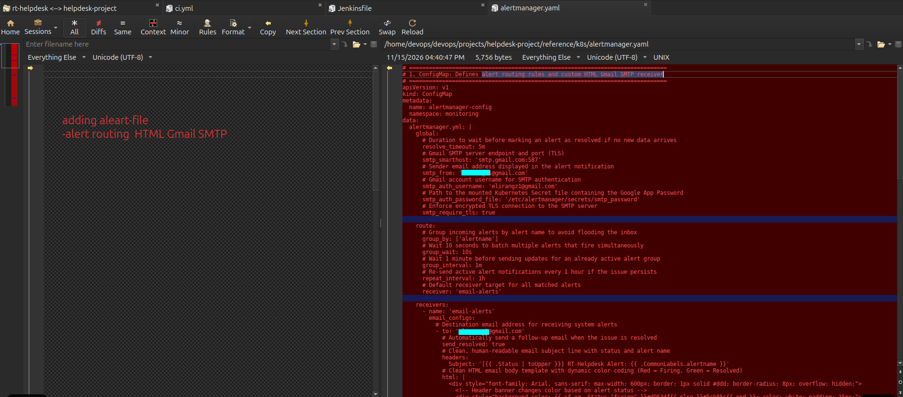
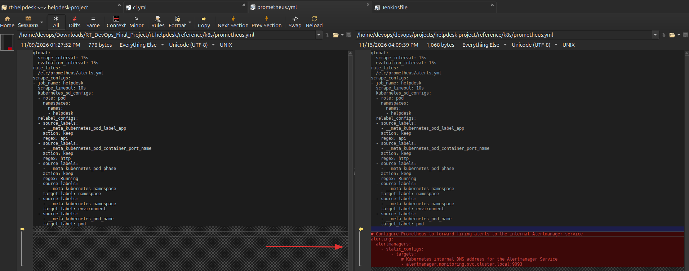
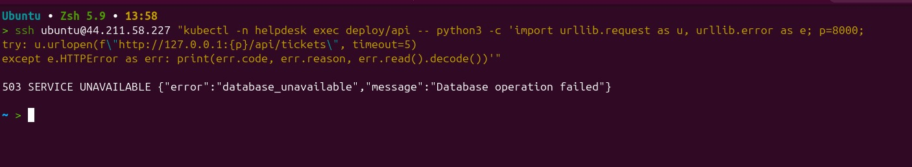
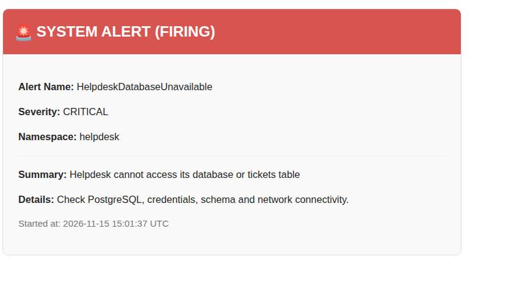

# RT-Helpdesk — End-to-End Cloud-Native DevOps Project

A production-grade deployment and automation pipeline for the **RT-Helpdesk** ticketing application. This project covers local containerization, Infrastructure as Code (IaC) on AWS, Kubernetes orchestration, automated CI/CD with Jenkins, real-time observability with Prometheus & Grafana, automated email alerting via Alertmanager, and verified disaster recovery.

---

## 1. System Architecture Diagram & Tech Stack

```text
[Developer / GitHub] 
       │
       ├──► [GitHub Actions] (PR Linting & Unit Tests)
       │
       └──► [Jenkins Controller & Build Agent (EC2 t3.micro)]
                   │  (Build, Test, Push Immutable Digest to GHCR)
                   ▼
            [GitHub Container Registry (GHCR)]
                   │
                   ▼  (Zero-Downtime Rollout via Restricted Kubeconfig)
       ┌───────────────────────────────────────────────────────┐
       │        AWS VPC — App Server (EC2 t3.small / Kind)     │
       │                                                       │
       │  ┌─────────────────────┐    ┌──────────────────────┐  │
       │  │ Namespace: helpdesk │    │ Namespace: monitoring│  │
       │  │  • API Deployment   │───►│  • Prometheus        │  │
       │  │  • PostgreSQL (PV)  │    │  • Grafana           │  │
       │  └──────────┬──────────┘    │  • Alertmanager      │  │
       └─────────────┼───────────────┴──────────┬───────────┘  │
                     │ (pg_dump)                │ (SMTP TLS)   │
                     ▼                          ▼              │
            [AWS S3 Backup Bucket]     [Gmail Alert Inbox]     │
```

| Layer | Technology | Implementation Details |
| :--- | :--- | :--- |
| **Cloud Infrastructure** | **AWS** (VPC, EC2, S3, IAM, Budgets) | Isolated VPC, Security Groups (SSH port 22 restricted to Admin IP `/32`), cost-optimized instances (`t3.micro` CI, `t3.small` App), encrypted S3 buckets, and 80% budget alerts. |
| **Infrastructure as Code** | **Terraform >= 1.10** | Two-stage architecture: `bootstrap` (versioned, encrypted S3 state bucket with native locking & `prevent_destroy`) and `lab` (compute, networking, IAM least-privilege roles). |
| **Containerization** | **Docker & Docker Compose** | Multi-stage production build running as non-root user with pinned base images and persistent volume storage. |
| **Orchestration** | **Kubernetes (Kind)** | Namespace isolation (`helpdesk`, `monitoring`), `StatefulSet` for PostgreSQL, Liveness/Readiness probes, and strict RBAC. |
| **CI/CD Automation** | **GitHub Actions, Jenkins & GHCR** | PR checks via GitHub Actions; production build, image digest push to GHCR, and K8s rollout/rollback via dedicated `helpdesk-build` agent. |
| **Observability & Alerting** | **Prometheus, Grafana, Alertmanager** | Metrics scraping (availability, request rate, error rate), Grafana dashboards, and HTML email alerts via Gmail SMTP (`FIRING` & `RESOLVED`). |
| **Backup & Recovery** | **AWS S3 & PostgreSQL** | Automated `pg_dump` backups uploaded to private S3 storage (`helpdesk-backups-egetz-2026`) and verified isolated database restores. |

---

## 2. Repository Structure

```text
helpdesk-project/
├── .github/workflows/            # GitHub Actions CI workflow for Pull Requests
├── app/                          # Python web application & automated test suite
├── docs/
│   └── images/                   # Verification screenshots & evidence
├── Dockerfile                    # Multi-stage hardened container definition
├── docker-compose.yml            # Local stack with PostgreSQL persistence
└── reference/
    ├── k8s/                      # Kubernetes manifests (App, DB, RBAC, Prometheus, Grafana, Alertmanager)
    ├── scripts/                  # Server setup, backup, restore, and synthetic traffic scripts
    └── terraform/
        ├── bootstrap/            # S3 remote state bucket & locking setup
        └── lab/                  # VPC, EC2, Security Groups, IAM, and AWS Budgets
```

---

## 3. Complete From-Scratch Build Guide (Weeks 1–6)

### Week 1: Local Docker, Persistence & Basic CI (GitHub Actions)
1. **Build and Run Locally with Docker Compose:**
   ```bash
   docker compose up -d --build
   curl -I http://localhost:8000
   ```
2. **Verify Database Persistence Across Restarts:**
   ```bash
   # Create a test ticket via UI/API, then recreate containers while keeping volumes
   docker compose down
   docker compose up -d
   # Confirm previously created tickets still exist in PostgreSQL
   ```
3. **GitHub Actions CI:**
   * Push code or open a Pull Request to trigger `.github/workflows/` automated linting and unit tests before merging to `main`.

---

### Week 2: Cloud Infrastructure Provisioning (Terraform & AWS)
1. **Bootstrap Remote Terraform State (S3 + Native Locking):**
   ```bash
   cd reference/terraform/bootstrap
   terraform init
   terraform apply -auto-approve
   # Record the output S3 bucket name (e.g., helpdesk-tfstate-<suffix>)
   ```
2. **Configure & Apply Lab Infrastructure (`VPC`, `EC2`, `S3`, `IAM`, `AWS Budgets`):**
   ```bash
   # Navigate to the main lab Terraform directory
   cd ../lab

   # Fetch your current public IP address to restrict SSH access exclusively to you
   MY_IP=$(curl -s ifconfig.me)

   # Create backend.hcl to configure remote state storage and native S3 locking
   cat << HCL > backend.hcl
   bucket       = "<YOUR_TFSTATE_BUCKET_NAME>" # S3 bucket created in the bootstrap step
   key          = "lab/terraform.tfstate"      # Path to the state file inside the bucket
   region       = "us-east-1"                  # AWS region for the state bucket
   encrypt      = true                         # Enable server-side encryption at rest
   use_lockfile = true                         # Enable native S3 state locking to prevent concurrent edits
   HCL

   # Create terraform.tfvars to supply environment-specific variables
   cat << VARS > terraform.tfvars
   aws_region         = "us-east-1"                        # Target AWS deployment region
   admin_cidr         = "${MY_IP}/32"                      # Lock SSH (port 22) strictly to your IP
   ssh_public_key     = "$(cat ~/.ssh/id_ed25519.pub)"     # Public SSH key injected into EC2 instances
   ci_instance_type   = "t3.micro"                         # Cost-optimized instance for Jenkins CI
   app_instance_type  = "t3.small"                         # Cost-optimized instance for Kubernetes App
   backup_bucket_name = "helpdesk-backups-egetz-2026"      # Private S3 bucket name for database backups
   VARS

   # Initialize Terraform and connect to the remote S3 backend
   terraform init -backend-config=backend.hcl

   # Preview the infrastructure changes and save the execution plan
   terraform plan -out=lab.plan

   # Provision all AWS resources defined in the saved plan
   terraform apply lab.plan
   ```

3. **Retrieve EC2 Instance Public & Private IPs:**
   ```bash
   aws ec2 describe-instances --region us-east-1 \
     --query "Reservations[].Instances[].{Name:Tags[?Key=='Name']|[0].Value,InstanceID:InstanceId,PublicIP:PublicIpAddress,PrivateIP:PrivateIpAddress,State:State.Name}" \
     --output table
   ```

---

### Week 3: Server Hardening & Kubernetes Deployment (Kind)
1. **Upload Project Files & Run Host Bootstrap Script on `<APP_PUBLIC_IP>`:**
   ```bash
   ssh ubuntu@<APP_PUBLIC_IP> "sudo mkdir -p /opt/rt-helpdesk && sudo chown -R ubuntu:ubuntu /opt/rt-helpdesk" # Create project dir & assign ownership
   scp -r app reference ubuntu@<APP_PUBLIC_IP>:/opt/rt-helpdesk/                                              # Copy app & reference files to server

   ssh ubuntu@<APP_PUBLIC_IP> "
     sudo apt-get update && sudo apt-get install -y docker.io curl jq postgresql-client awscli         # Install Docker, CLI tools & DB client
     sudo usermod -aG docker ubuntu                                                                    # Grant ubuntu user non-sudo Docker access
     curl -Lo ./kind https://kind.sigs.k8s.io/dl/v0.24.0/kind-linux-amd64                              # Download Kind binary for Linux AMD64
     chmod +x ./kind && sudo mv ./kind /usr/local/bin/kind                                             # Make Kind executable & move to PATH
     curl -LO https://dl.k8s.io/release/v1.31.0/bin/linux/amd64/kubectl                                # Download kubectl CLI binary
     chmod +x kubectl && sudo mv kubectl /usr/local/bin/kubectl                                        # Make kubectl executable & move to PATH
     kind create cluster --name helpdesk                                                               # Spin up local 'helpdesk' K8s cluster
   "
   ```
2. **Deploy Namespaces, RBAC, PostgreSQL & RT-Helpdesk Application:**
   ```bash
   ssh ubuntu@<APP_PUBLIC_IP> "
     cd /opt/rt-helpdesk                                                                               # Navigate to project directory on server
     kubectl create namespace helpdesk                                                                 # Create isolated namespace for app & DB
     kubectl create namespace monitoring                                                               # Create isolated namespace for monitoring
     kubectl apply -f reference/k8s/jenkins-rbac.yaml                                                  # Apply least-privilege RBAC for Jenkins
     kubectl apply -f reference/k8s/app.yaml                                                           # Deploy FastAPI app & PostgreSQL DB
     kubectl -n helpdesk get pods                                                                      # Verify all pods are in Running state
   "
   ```

---

### Week 4: Full CI/CD Automation & Rollback (Jenkins & GHCR)
1. **Install Jenkins & Configure Dedicated Build Agent (`buildagent`) on `<CI_PUBLIC_IP>`:**
   ```bash
   ssh ubuntu@<CI_PUBLIC_IP> "
     sudo apt-get update && sudo apt-get install -y fontconfig openjdk-17-jre docker.io git            # Install Java 17, Docker Engine & Git
     sudo wget -O /usr/share/keyrings/jenkins-keyring.asc https://pkg.jenkins.io/debian-stable/jenkins.io-2026.key                           # Import Jenkins GPG key
     echo 'deb [signed-by=/usr/share/keyrings/jenkins-keyring.asc] https://pkg.jenkins.io/debian-stable binary/' | sudo tee /etc/apt/sources.list.d/jenkins.list > /dev/null # Add Jenkins apt repo
     sudo apt-get update && sudo apt-get install -y jenkins                                            # Install Jenkins controller package
     sudo systemctl enable --now jenkins                                                               # Enable & start Jenkins service

     sudo useradd -m -s /bin/bash buildagent                                                           # Create dedicated non-root CI agent user
     sudo usermod -aG docker buildagent                                                                # Grant buildagent access to Docker daemon
     sudo -u jenkins ssh-keygen -t ed25519 -f /var/lib/jenkins/.ssh/id_ed25519 -N ''                   # Generate SSH keypair for Jenkins master
     sudo mkdir -p /home/buildagent/.ssh                                                               # Create SSH config dir for buildagent
     sudo cp /var/lib/jenkins/.ssh/id_ed25519.pub /home/buildagent/.ssh/authorized_keys                # Authorize Jenkins master key on agent
     sudo chown -R buildagent:buildagent /home/buildagent/.ssh                                         # Set proper ownership on .ssh folder
     sudo chmod 700 /home/buildagent/.ssh && sudo chmod 600 /home/buildagent/.ssh/authorized_keys      # Enforce strict SSH file permissions
   "
   ```

2. **Authorize Jenkins SSH Access to App Server (via `<APP_PRIVATE_IP>` for internal VPC rollout) & Configure Pipeline:**
   ```bash
   JENKINS_PUB=$(ssh ubuntu@<CI_PUBLIC_IP> "sudo cat /var/lib/jenkins/.ssh/id_ed25519.pub") # Retrieve Jenkins public SSH key
   ssh ubuntu@<APP_PUBLIC_IP> "echo '$JENKINS_PUB' >> ~/.ssh/authorized_keys"               # Authorize key on App server for deployments
   ```

   #### Step-by-Step Jenkins UI Setup (`http://localhost:8080`)
   1. **Unlock Jenkins:**
      * Open an SSH tunnel (`ssh -L 8080:127.0.0.1:8080 ubuntu@<CI_PUBLIC_IP> -N`) and browse to `http://localhost:8080`.
      * Retrieve the initial password via `ssh ubuntu@<CI_PUBLIC_IP> "sudo cat /var/lib/jenkins/secrets/initialAdminPassword"`, install suggested plugins, and create your admin user.
   2. **Add SSH Credential for Build Agent (`buildagent-ssh`):**
      * Go to **Manage Jenkins -> Credentials -> System -> Global credentials -> + Add Credentials**.
      * Select **SSH Username with private key**, set **ID** to `buildagent-ssh`, **Username** to `buildagent`, and paste the private key from `/var/lib/jenkins/.ssh/id_ed25519`.
   3. **Add GHCR & Kubeconfig Credentials:**
      * **GHCR Token:** Add a **Username with password** credential (ID: `ghcr-creds`) using your GitHub username and a Personal Access Token (PAT) with `write:packages` scope.
      * **Restricted Kubeconfig:** Extract the restricted kubeconfig for the Jenkins RBAC service account from `<APP_PUBLIC_IP>` and upload it as a **Secret file** credential (ID: `helpdesk-kubeconfig`).
   4. **Register Dedicated Build Agent (`helpdesk-build`):**
      * Go to **Manage Jenkins -> Nodes -> + New Node**.
      * Enter name **`helpdesk-build`**, select **Permanent Agent**, and click **Create**.
      * Set **Remote root directory** to `/home/buildagent`, **Labels** to `helpdesk-build`, **Launch method** to **Launch agents via SSH**, **Host** to `127.0.0.1`, select `buildagent-ssh` credentials, and click **Save**.
   5. **Create & Run Release Pipeline (`helpdesk-release`):**
      * Click **+ New Item**, enter **`helpdesk-release`**, select **Pipeline**, and click **OK**.
      * Under **Pipeline -> Definition**, choose **Pipeline script from SCM**, select **Git**, enter your repository URL, set **Branch Specifier** to `*/main`, **Script Path** to `Jenkinsfile`, and click **Save**.
      * Click **Build Now** to execute the full automated build, test, digest push, and Kubernetes rollout.

3. **Rollback Procedure (In Case of Failed Deployment):**
   ```bash
   ssh ubuntu@<APP_PUBLIC_IP> "
     kubectl -n helpdesk rollout undo deployment/api && \   # Revert the 'api' Deployment to the previous stable revision
     kubectl -n helpdesk rollout status deployment/api      # Wait and verify that the rolled-back Pods are healthy and ready
   "
   ```
   * **What these commands do:**
     * **`kubectl -n helpdesk rollout undo deployment/api`:** Immediately rolls back the `api` Deployment in the `helpdesk` namespace to its last known working image digest and configuration.
     * **`kubectl -n helpdesk rollout status deployment/api`:** Monitors the rollback progress in real time until all replacement Pods pass their Readiness probes and serve traffic normally.


### Week 5: Monitoring, Alertmanager & S3 Backup/Restore
1. **Deploy Prometheus, Grafana & Alertmanager (Gmail SMTP):**
   ```bash
   ssh ubuntu@<APP_PUBLIC_IP> "
     cd /opt/rt-helpdesk
     kubectl -n monitoring create secret generic alertmanager-smtp \
       --from-literal=smtp_password='<YOUR_16_CHAR_GOOGLE_APP_PASSWORD>'
     kubectl -n monitoring create configmap prometheus-config \
       --from-file=prometheus.yml=reference/k8s/prometheus.yml \
       --from-file=alerts.yml=reference/k8s/alerts.yml
     kubectl apply -f reference/k8s/monitoring.yaml
     kubectl apply -f reference/k8s/alertmanager.yaml
     kubectl -n monitoring get pods
   "
   ```

   * **What this command does:**
     * **Secret Injection (`alertmanager-smtp`):** Creates an encrypted Kubernetes Secret for the Gmail App Password so credentials never touch Git.
     * **Configuration Reload (`--dry-run=client -o yaml | kubectl apply` & `rollout restart`):** Safely updates the existing `prometheus-config` ConfigMap in-place and restarts the Prometheus pod so it immediately connects to Alertmanager.

2. **Generate Traffic & Verify Metrics (Availability, Request Rate, Error Rate):**
   ```bash
   python3 reference/scripts/traffic.py --seconds 180
   ```
3. **Run Automated S3 Backup & Isolated Database Restore Verification:**
   ```bash
   # Backup to S3
   ssh ubuntu@<APP_PUBLIC_IP> "bash /opt/rt-helpdesk/reference/scripts/k8s-backup.sh helpdesk helpdesk-backups-egetz-2026" # Run pg_dump inside db-0 & upload dump to S3
   aws s3 ls s3://helpdesk-backups-egetz-2026/backups/helpdesk/                                                        # List S3 bucket to confirm backup upload

   # Isolated Restore Check
   ssh ubuntu@<APP_PUBLIC_IP> "
     aws s3 cp s3://helpdesk-backups-egetz-2026/backups/helpdesk/<LATEST_DUMP>.dump /tmp/restore.dump && \            # Download latest dump file from S3 to host
     kubectl -n helpdesk cp /tmp/restore.dump db-0:/tmp/restore.dump && \                                             # Copy dump file into the PostgreSQL Pod
     kubectl -n helpdesk exec db-0 -- psql -U postgres -c 'CREATE DATABASE helpdesk_restore_check1;' && \             # Create a clean isolated database for testing
     kubectl -n helpdesk exec db-0 -- pg_restore -U postgres -d helpdesk_restore_check1 /tmp/restore.dump && \        # Restore schema and data into temp database
     kubectl -n helpdesk exec db-0 -- psql -U postgres -d helpdesk_restore_check1 -c '\dt' && \                        # List tables to verify successful restoration
     kubectl -n helpdesk exec db-0 -- psql -U postgres -c 'DROP DATABASE helpdesk_restore_check1;'                    # Drop temporary database after verification
   "
   ```
   * **What these commands do:**
     * **Backup & Verification (`k8s-backup.sh` & `aws s3 ls`):** Executes a compressed `pg_dump` against the live PostgreSQL instance, uploads it to your private S3 bucket, and verifies the artifact's presence in cloud storage.
     * **Isolated Restore Check (`pg_restore`):** Downloads the backup from S3 and restores it into a separate temporary database (`helpdesk_restore_check1`) inside `db-0`, confirming data integrity without risking or overwriting live production tables.


### Week 6: Cost Control, Operations & Final Teardown
* **Open Local SSH Tunnels to Web Interfaces:**
  ```bash
  # App (8000), Prometheus (9090), Grafana (3000)
  ssh -L 8000:127.0.0.1:8000 -L 9090:127.0.0.1:9090 -L 3000:127.0.0.1:3000 ubuntu@<APP_PUBLIC_IP>

  # Jenkins (8080)
  ssh -L 8080:127.0.0.1:8080 ubuntu@<CI_PUBLIC_IP> -N
  ```
* **Pause Lab Between Sessions (Stop EC2 Instances):**
  ```bash
  aws ec2 stop-instances --region us-east-1 --instance-ids <CI_INSTANCE_ID> <APP_INSTANCE_ID>
  ```
* **Final Environment Destruction After Grading (`Teardown` — Zero Cost):**
  ```bash
  aws s3 rm s3://helpdesk-backups-egetz-2026 --recursive
  cd ~/devops/projects/helpdesk-project/reference/terraform/lab
  terraform destroy -auto-approve
  ```

---

## 4. Security & Cost Optimization Highlights

* **Zero Public App Ports:** No HTTP/HTTPS, database, Jenkins, Prometheus, or Grafana ports are exposed to the public internet. All administrative access uses encrypted **SSH Local Port Forwarding**.
* **Secrets Management:** Sensitive credentials (such as Gmail SMTP App Passwords and GHCR tokens) are never committed to Git; they are injected at runtime using **Kubernetes Secrets** (`readOnly: true` volume mounts) and Jenkins Credentials.
* **Least-Privilege IAM:** The application EC2 instance uses an IAM role restricted strictly to S3 backup object operations, with zero infrastructure-admin permissions.
* **Cost-Optimized Compute:** Instance types in `variables.tf` and `terraform.tfvars` are tuned to `t3.micro` (Jenkins) and `t3.small` (Kubernetes App) alongside AWS Budgets alerts to prevent unexpected cloud spend.

---

## 5. Alertmanager & Gmail SMTP Configuration

To enable real-time email notifications without incurring extra third-party email service costs, **Prometheus Alertmanager** is configured to relay alerts through Google's free SMTP server (`smtp.gmail.com:587`) using TLS encryption and a dedicated **Google App Password**.

* **Kubernetes Secret (`alertmanager-smtp`):** Stores the App Password securely inside the `monitoring` namespace and mounts it read-only at `/etc/alertmanager/secrets/smtp_password`.
* **Dynamic HTML Notifications (`reference/k8s/alertmanager.yaml`):** Configured `send_resolved: true` with a custom HTML template rendering a **Red (`[FIRING]`)** banner on outage and a **Green (`[RESOLVED]`)** banner upon recovery.



* **Prometheus Integration (`reference/k8s/prometheus.yml`):** Routes alerts to `alertmanager.monitoring.svc.cluster.local:9093`.




---

## 6. Operational Exercises & Verification Evidence

### Exercise 1: End-to-End Application & Observability Health
* **RT-Helpdesk Web UI (`http://localhost:8000`):**
  
* **Prometheus Scrape Targets (`http://localhost:9090/targets`):**
  
* **Grafana Live Dashboard (`http://localhost:3000`):**
  

### Exercise 2: Jenkins Dedicated Build Agent Verification
1. Open Jenkins (`http://localhost:8080`) -> **+ New Item** -> name **`agent-verify`** -> **Pipeline**.
2. Paste the verification script under **Pipeline script**, save, and click **Build Now**:
   ```groovy
   pipeline {
     agent { label 'helpdesk-build' }
     stages {
       stage('Verify Build Agent') {
         steps {
           sh 'id -un && docker version'
         }
       }
     }
   }
   ```
* **Jenkins Console Output (`id -un` & `docker version`):**
  

### Exercise 3: Database Outage & Graceful Degradation (Chaos Exercise)
Scaled PostgreSQL `StatefulSet` to `0` (`kubectl -n helpdesk scale statefulset db --replicas=0`) to verify that the API stays alive (Liveness passes), fails Readiness, returns **`503 Service Unavailable`**, and triggers `HelpdeskDatabaseUnavailable` (`FIRING`) in Prometheus.

* **API Graceful Degradation (`503 Service Unavailable`):**
  
* **Prometheus Firing Alert (`http://localhost:9090/alerts`):**
  

### Exercise 4: Real-Time Email Alerting & Auto-Recovery (Alertmanager)
* **Firing Alert Email Notification:**
  
* **Resolved Recovery Email Notification:**
  

---

##  Quick Access & SSH Tunneling Guide

Because no application, database, CI, or monitoring ports are exposed to the public internet, all web interfaces are accessed securely via **SSH Local Port Forwarding**.

### Network Addressing & IP Usage (`PublicIP` vs. `PrivateIP`)

| Connection Type | Source | Destination | IP Address Used | Persistence |
| :--- | :--- | :--- | :--- | :--- |
| **Admin SSH & File Transfers (`scp`)** | Local Workstation | App / CI EC2 Instance | **`PublicIP`** (`<APP_PUBLIC_IP>`, `<CI_PUBLIC_IP>`) | Dynamic (changes on EC2 Stop/Start) |
| **SSH Local Port Forwarding (Tunnels)** | Local Browser (`localhost`) | App / Monitoring / Jenkins | **`PublicIP`** (`<APP_PUBLIC_IP>`, `<CI_PUBLIC_IP>`) | Dynamic (changes on EC2 Stop/Start) |
| **Automated CI/CD K8s Rollouts** | Jenkins CI Server (`10.42.1.179`) | Kubernetes App Server (`10.42.1.9`) | **`PrivateIP`** (`<APP_PRIVATE_IP>` — `10.42.1.9`) | Static (fixed inside AWS VPC) |
| **Internal VPC Traffic** | EC2 Instances | AWS S3 / Internal Services | **`PrivateIP`** (`10.42.1.x`) | Static (fixed inside AWS VPC) |

---

### 1. Retrieve Current EC2 Public IPs
If you stopped and restarted your EC2 instances, fetch their updated public IP addresses first:
```bash
AWS_PAGER="" aws ec2 describe-instances --region us-east-1 \
  --filters "Name=tag:Name,Values=*helpdesk*" \
  --query "Reservations[].Instances[].{Name:Tags[?Key=='Name']|[0].Value,InstanceID:InstanceId,PublicIP:PublicIpAddress,PrivateIP:PrivateIpAddress,State:State.Name}" \
  --output table
```
* **`<APP_PUBLIC_IP>`:** Public IP of the Kubernetes Application server (`10.42.1.9`).
* **`<CI_PUBLIC_IP>`:** Public IP of the Jenkins CI server (`10.42.1.179`).


---

### 2. Individual Service Tunnels (Separate Terminals)

| Service | Local URL | SSH Tunnel Command |
| :--- | :--- | :--- |
| **RT-Helpdesk App** | `http://localhost:8000` | `ssh -o StrictHostKeyChecking=no -L 8000:127.0.0.1:8000 ubuntu@<APP_PUBLIC_IP> "kubectl -n helpdesk port-forward service/api 8000:8000"` |
| **Prometheus UI** | `http://localhost:9090` | `ssh -o StrictHostKeyChecking=no -L 9090:127.0.0.1:9090 ubuntu@<APP_PUBLIC_IP> "kubectl -n monitoring port-forward service/prometheus 9090:9090"` |
| **Grafana Dashboard** | `http://localhost:3000` | `ssh -o StrictHostKeyChecking=no -L 3000:127.0.0.1:3000 ubuntu@<APP_PUBLIC_IP> "kubectl -n monitoring port-forward service/grafana 3000:3000"` |
| **Jenkins Controller** | `http://localhost:8080` | `ssh -o StrictHostKeyChecking=no -L 8080:127.0.0.1:8080 ubuntu@<CI_PUBLIC_IP> -N` |

---

### 3. Combined All-in-One App Server Tunnel (Single Terminal)
To open **RT-Helpdesk (8000)**, **Prometheus (9090)**, and **Grafana (3000)** simultaneously in one terminal window:
```bash
ssh -o StrictHostKeyChecking=no -L 8000:127.0.0.1:8000 -L 9090:127.0.0.1:9090 -L 3000:127.0.0.1:3000 ubuntu@<APP_PUBLIC_IP> \
  "kubectl -n helpdesk port-forward service/api 8000:8000 & kubectl -n monitoring port-forward service/prometheus 9090:9090 & kubectl -n monitoring port-forward service/grafana 3000:3000 & wait"
```

---

### 4. Close All Active SSH Tunnels
* **Single terminal:** Press **`Ctrl` + `C`**.
* **Terminate all background tunnels at once:**
  ```bash
  pkill -f "ssh .*127.0.0.1:"
  ```
## 7. End-to-End Automated Environment Provisioning (`rebuild-all.sh`)

To eliminate manual configuration drift and ensure full reproducibility across environments, this repository includes a single-command end-to-end provisioning script (`reference/scripts/rebuild-all.sh`).

### What It Automates
1. **Zero-Touch Secrets & Network Detection:** Securely loads credentials from a local out-of-repo file (`~/.helpdesk-secrets.env`), dynamically detects the administrator's public IP for security group restrictions, and verifies the S3 remote state backend.
2. **Infrastructure as Code (Terraform):** Provisions the complete AWS VPC, EC2 instances (`app` and `ci`), IAM roles, security groups, and AWS Billing Budget alerts.
3. **Kubernetes Cluster & Application Bootstrap:** Installs Docker, Kind, and `kubectl` on the application node, initializes the cluster, generates runtime secrets, deploys the PostgreSQL database and Helpdesk API from an immutable GHCR digest, and runs database schema initialization (`init-db`) and seeding (`seed-db`).
4. **Full Observability Stack:** Deploys Prometheus, Grafana, and Alertmanager with pre-configured scrape targets, alert rules, and SMTP secrets.
5. **Jenkins Configuration as Code (JCasC):** Installs Jenkins and a dedicated `buildagent`, exchanges SSH keys between nodes, installs required plugins via `jenkins-plugin-manager`, and applies `jenkins.yaml` via JCasC—automatically injecting the new internal `APP_HOST` IP and verifying readiness.

### Engineering & Learning Value
* **True Reproducibility & Cost Efficiency:** Enables spinning up the entire cloud stack from scratch in minutes for testing or demonstrations and tearing it down cleanly afterward with zero manual setup steps.
* **Security Best Practices:** Enforces strict separation between version-controlled infrastructure code and sensitive credentials, dynamically generating Kubernetes secrets at runtime.
* **Full-Stack DevOps Integration:** Bridges cloud networking, container orchestration, declarative CI/CD configuration, and automated monitoring into a cohesive, idempotent workflow.

### Quick Usage (3-Step Workflow)
```bash
# 1. Provision the entire infrastructure, Kubernetes cluster, monitoring, and Jenkins CI
bash reference/scripts/rebuild-all.sh

# 2. Open SSH port-forwarding tunnels to access all interfaces locally
helpdesk-tunnel

# 3. Trigger the CI/CD pipeline in Jenkins:
#    Open http://localhost:8080/job/helpdesk-release/ and click "Build Now"
#    to build, push, and roll out the latest commit from GitHub.
```

---

### Recommended Shell Aliases & Lifecycle Shortcuts

For fast daily management and AWS cost optimization, it is recommended to define shell aliases and helper functions in your shell profile (`~/.zshrc` for Zsh or `~/.bashrc` for Bash).

#### How to Create and Activate the Aliases
1. **Store Credentials Locally (One-Time Setup):** Create `~/.helpdesk-secrets.env` outside the Git repository (`chmod 600 ~/.helpdesk-secrets.env`) containing your `TFSTATE_BUCKET`, `BUDGET_EMAIL`, `SMTP_PASS`, `JENKINS_ADMIN_PASSWORD`, `GRAFANA_ADMIN_PASSWORD`, and `GITHUB_PAT`.
2. **Add Definitions to Shell Profile:** Append the aliases and functions below to `~/.zshrc` (or `~/.bashrc`).
3. **Reload Shell Configuration:** Run `source ~/.zshrc` (or `source ~/.bashrc`) so the shortcuts become immediately available in your terminal.

#### Alias Reference & Underlying Commands

| Alias | Purpose | Underlying Command / Logic |
| :--- | :--- | :--- |
| **`aws-up`** | Full Provisioning | `bash ~/devops/projects/helpdesk-project/reference/scripts/rebuild-all.sh` — Runs the full end-to-end Terraform, Kubernetes, Monitoring, and Jenkins JCasC setup. |
| **`aws-down`** | Full Teardown | `(cd ~/devops/projects/helpdesk-project/reference/terraform/lab && terraform destroy)` — Destroys all Terraform-managed AWS resources to eliminate ongoing cloud costs. |
| **`aws-stop`** | Pause Instances | `aws ec2 stop-instances --instance-ids <APP_ID> <CI_ID>` — Queries running `rt-helpdesk` EC2 instance IDs and stops them cleanly at the end of a work session. |
| **`aws-start`** | Resume Instances | `aws ec2 start-instances --instance-ids <APP_ID> <CI_ID>` — Starts stopped EC2 instances, updates dynamic IP configurations (`APP_PRIV_IP` and `known_hosts`), and restores cluster connectivity. |
| **`aws-check`** | Status Audit | `aws ec2 describe-instances --filters "Name=tag:Name,Values=*rt-helpdesk*" --output table` — Lists all project EC2 instances with their current state (`running`, `stopped`, or empty after `aws-down`). |
| **`helpdesk-tunnel`** | Local Port-Forwarding | Opens background SSH tunnels (`ssh -L`) forwarding local ports **`8080`** (Jenkins), **`8000`** (Helpdesk App via `kubectl port-forward`), **`9090`** (Prometheus), and **`3000`** (Grafana) to `127.0.0.1`. |

#### Example Shell Profile Block (`~/.zshrc` / `~/.bashrc`)
```bash
# RT-Helpdesk Lifecycle Shortcuts
alias aws-up='bash ~/devops/projects/helpdesk-project/reference/scripts/rebuild-all.sh'
alias aws-down='(cd ~/devops/projects/helpdesk-project/reference/terraform/lab && terraform destroy)'
alias aws-check='aws ec2 describe-instances --region us-east-1 --filters "Name=tag:Name,Values=*rt-helpdesk*" "Name=instance-state-name,Values=pending,running,stopping,stopped" --query "Reservations[].Instances[].[Tags[?Key==\`Name\`]|[0].Value,InstanceId,State.Name,PublicIpAddress]" --output table'
alias aws-stop='IDS=\((aws ec2 describe-instances --region us-east-1 --filters "Name=tag:Name,Values=*rt-helpdesk*" "Name=instance-state-name,Values=running" --query "Reservations[].Instances[].InstanceId" --output text) && [ -n "\)IDS" ] && aws ec2 stop-instances --region us-east-1 --instance-ids \$IDS'
alias aws-start='IDS=\((aws ec2 describe-instances --region us-east-1 --filters "Name=tag:Name,Values=*rt-helpdesk*" "Name=instance-state-name,Values=stopped" --query "Reservations[].Instances[].InstanceId" --output text) && [ -n "\)IDS" ] && aws ec2 start-instances --region us-east-1 --instance-ids \$IDS'

# Opens secure local SSH port-forwarding tunnels to all 4 project web interfaces
helpdesk-tunnel() {
  # 1. Dynamically query AWS EC2 for the current Public IPs of the running CI and App servers
  echo "Fetching live IPs from AWS..."
  local CI_IP APP_IP
  CI_IP=\$(aws ec2 describe-instances --region us-east-1 --filters "Name=tag:Name,Values=*rt-helpdesk*ci*" "Name=instance-state-name,Values=running" --query "Reservations[0].Instances[0].PublicIpAddress" --output text)
  APP_IP=\$(aws ec2 describe-instances --region us-east-1 --filters "Name=tag:Name,Values=*rt-helpdesk*app*" "Name=instance-state-name,Values=running" --query "Reservations[0].Instances[0].PublicIpAddress" --output text)

  # 2. Validate that both instances are running before attempting to open SSH connections
  if [ -z "\(CI_IP" ] ert{}ert{} [ "\)CI_IP" = "None" ] || [ -z "\(APP_IP" ] ert{}ert{} [ "\)APP_IP" = "None" ]; then
    echo "Error: Could not find running CI or App instances."
    return 1
  fi

  # 3. Start a background SSH tunnel mapping local port 8080 to Jenkins on the CI server
  echo "Opening Jenkins tunnel (http://localhost:8080 -> \${CI_IP})..."
  ssh -o StrictHostKeyChecking=no -N -L 8080:127.0.0.1:8080 ubuntu@"\$CI_IP" &
  local CI_PID=\$!

  # 4. Register a cleanup trap to terminate the background Jenkins tunnel when Ctrl+C is pressed
  trap "kill \$CI_PID 2>/dev/null || true" EXIT INT TERM

  # 5. Open an SSH session to the App server forwarding ports 8000 (App), 9090 (Prometheus), and 3000 (Grafana)
  #    while running kubectl port-forward inside the remote Kind cluster
  echo "Opening App, Prometheus & Grafana tunnels (8000, 9090, 3000 -> \${APP_IP})..."
  echo "Keep this terminal open while browsing. Press Ctrl+C to close tunnels."
  ssh -o StrictHostKeyChecking=no -L 8000:127.0.0.1:8000 -L 9090:127.0.0.1:9090 -L 3000:127.0.0.1:3000 ubuntu@"\$APP_IP" "
    kubectl -n helpdesk port-forward service/api 8000:8000 >/dev/null 2>&1 &
    kubectl -n monitoring port-forward service/prometheus 9090:9090 >/dev/null 2>&1 &
    kubectl -n monitoring port-forward service/grafana 3000:3000 >/dev/null 2>&1 &
    wait
  "
}
```

#### How `helpdesk-tunnel` Works
* **Dynamic IP Discovery:** Automatically fetches the latest public IP addresses of the `ci` and `app` EC2 instances from AWS, eliminating the need to update SSH commands after stop/start cycles.
* **Multi-Service Forwarding:** Simultaneously exposes **Jenkins** (`localhost:8080`), the **Helpdesk Web UI** (`localhost:8000`), **Prometheus** (`localhost:9090`), and **Grafana** (`localhost:3000`) over encrypted SSH tunnels without opening public inbound ports in AWS Security Groups.
* **Clean Teardown (`trap`):** Ensures background SSH processes are cleanly terminated when exiting with `Ctrl+C`.

> **Tip:** Always run **`aws-check`** after **`aws-down`** to verify that zero residual EC2 instances remain active in your AWS account.
